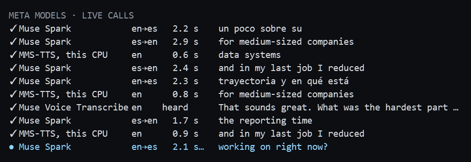

# traductor-meta-hackathon

**OS-level simultaneous interpreter, Spanish ⇄ English, for any video call**, built on Meta's **Muse Voice Transcribe** (realtime ASR), **Muse Spark** (translation) and **MMS-TTS** (the voice). You speak Spanish, or Spanglish, into your normal microphone and the other side hears fluent English. They speak English and you hear their words in Spanish, on your speakers or headphones, and read them as subtitles.

**Any meeting app, one setting.** It runs beside the call app, at the level of Windows, not inside it, so it is meant for all of them: Google Meet, Microsoft Teams, Zoom, Webex, Discord, or any other app that lets you pick a microphone. **The only thing to set in the call app is the microphone: `CABLE Output`**, the virtual microphone that carries the English. No plugin, no extension, and nothing to install on the other side. Your speakers or headphones stay as they are: the app subtitles whatever the call plays on them. With the [synchronized dub](#7-synchronized-dub-optional), also pick `OBS Virtual Camera` as the camera. Tested with Google Meet; the others take a microphone the same way, but were not tried.

Track: **Indie Developer** · Theme: **Build for Your World**. I understand English but I am slow to speak it under pressure (interviews, meetings). This is "work in English today", not "learn English".

> **Windows 11 only, and tested there.** Every test, gate and measurement in this README, and the demo video, were made on one Windows 11 Pro PC (build 26200, AMD Ryzen 9 6900HX, 32 GB of RAM), with the voice on the CPU. To run it, double-click **`Install.bat`**: Muse Spark guides the setup with tool calls. Then follow the [manual](#manual-windows-11) for your first call.

## Status

Work in progress during the hackathon week. Daily logs with measured numbers live in [`docs/log/`](docs/log/).

| Piece | State |
|---|---|
| Repo, SPEC, contracts, clock, seq-ordered deadline scheduler | done |
| Realtime ASR client (Muse Voice Transcribe) | done |
| Outgoing consecutive chain: mic → ASR → Spark → TTS → virtual mic | done, measured with a real voice |
| Incoming chain: loopback → ASR → Spark → subtitles | done, measured on real system audio |
| Safety: silent rest state, F9 latch, F10 via Core Audio, watchdog, restore on exit | done, physical keys pending |
| Incremental clause commits (LA-2), both directions | done, measured on synthetic voices |
| Synchronized dub with fixed delay D | done; measured on synthetic voices and with my own voice (gate S passed, 30 of 30 clauses), picture and sound calibrated with real claps (+23 ms); tried in a Google Meet call with my phone as the other side, Nov 2 |
| Spanglish: English that falls into Spanish comes out as one English voice | done and measured on a synthetic voice; the ASR sometimes drops whole Spanish passages |
| Turns: their sustained speech takes the floor from my voice | done, measured with both fixtures talking over each other |
| Context: the whole conversation and a glossary reach Spark | done, measured on latency and on ambiguous clauses |
| One-button widget and draggable metrics line | done, and used in the Google Meet calls of Nov 2; F7 and F10 not yet pressed in a call |
| Meta end to end: MMS-TTS on this PC is the voice | done, judged by ear and measured with a real voice; heard on a phone through Google Meet, Nov 2 |
| Setup assistant: `Install.bat`, with Muse Spark driving a fixed set of tools | done; run on this PC with real Spark, every change declined, Nov 2; not yet tried on a clean PC |
| Their words in Spanish out loud (MMS-TTS Spanish), the app deaf to the loopback while it speaks | done; run on the fixtures into a file, Nov 3: 13 clauses, 0.25 to 0.97 s each to synthesize; not yet heard in a call |
| Speakers: my mic waits while the PC plays, so the call goes in turns; headphones keep full duplex | done; [gate R](#metrics) offline, with the room's echo mixed into my mic, Nov 3: their words went back in 8 of 23 clauses without it, 0 of 11 with it; not yet tried on real speakers |

## How it works (short)

```
OUT: mic ─► Muse Voice Transcribe (es) ─► clause commits ─► Muse Spark (es→en) ─► MMS-TTS (local) ─► scheduler ─► VB-CABLE ─► call app
IN:  system loopback ─► Muse Voice Transcribe (en) ─► Muse Spark (en→es) ─► subtitle overlay + MMS-TTS (es, local) ─► speakers or headphones
ROOM: on speakers, the loopback's level ─► the mic hands on silence while the PC plays, and 0.6 s after (turns)
SETUP: Install.bat ─► uv sync ─► Muse Spark picks the next tool (tool calling) ─► fixed tools ask you, then act ─► warmcheck
```

Design, contracts, clock model and safety rules: [`docs/SPEC.md`](docs/SPEC.md).

### Meta models used and where they run

| Model | What it does | How it is called | Code |
|---|---|---|---|
| Muse Voice Transcribe (`muse-voice-transcribe-1.0`) | Hears both sides as they speak: partial text, the end of each turn, and timing events that decide when a clause is ready and when it must play | Meta Model API, realtime WebSocket `wss://api.meta.ai/v1/asr/realtime`, 16 kHz PCM | [`asr/meta_realtime.py`](src/interprete/asr/meta_realtime.py) |
| Muse Spark (`muse-spark-1.3`) | Translates each clause both ways, with the whole conversation and the glossary; drives the setup assistant with tool calls | Meta Model API, chat completions at `https://api.meta.ai/v1`: structured output with `reasoning_effort` minimal to translate, tools with low in the setup | [`mt/spark.py`](src/interprete/mt/spark.py), [`mt/context.py`](src/interprete/mt/context.py), [`setup/assistant.py`](src/interprete/setup/assistant.py) |
| MMS-TTS (`facebook/mms-tts-eng`, `facebook/mms-tts-spa`) | Speaks my English to the other side, and their words in Spanish to me | Open weights through `transformers`, on this PC's CPU, 4 threads each | [`tts/mms.py`](src/interprete/tts/mms.py), [`audio/speaker.py`](src/interprete/audio/speaker.py) |

Every call shows on screen as it runs, in the Meta panel: which model, how long it has been out or how long it took, and what it returned, from the moment the voice starts loading. Blue is a call still out, white one that returned, red one that failed. The console prints the same, such as `Muse Spark es→en  1.2 s │ Sure. In my last project…`, and every run writes each call with its timing to `logs/app_<date>_<time>.jsonl`.



`scripts/make_fixtures.py` also makes the test voices with both models.

Honest notes:
- **Meta's Model API has no text-to-speech model** (checked against the docs, the live model list and the cookbook on Oct 30), so the voice is Meta's open-weight MMS-TTS on this PC. The voice is plain and single-speaker, chosen because the rules require Meta models end to end. It has no backup: nothing that is not Meta's runs, even when something fails.
- The interpreter requires Windows 11 and [VB-CABLE](https://vb-audio.com/Cable/).
- **On speakers the call goes in turns.** The app takes your microphone straight from the device, so the call app's echo cancelling never touches it, and on speakers the mic would hear the other side and the Spanish voice and translate them back. So while the PC plays, and 0.6 s after, the mic hands on silence ([`audio/room.py`](src/interprete/audio/room.py)) and the button says `MIC ON HOLD`: what you say then is lost, so speak on `LIVE`. The loopback's level says when, against the quietest moment of the last 5 s, so a steady hum on their side does not keep the mic shut. Headphones need none of it and let you talk over the other side: the app goes in turns unless the default output is named like headphones, and `RTT_SPEAKERS` decides by hand. Full duplex on speakers would need echo cancelling against the loopback: not done.
- **Their words in Spanish cost a little of what they say.** The Spanish voice plays where the app listens, on the default output, so while it speaks, and 0.4 s after, the app hears nothing: what they say in that moment gets neither a subtitle nor a voice. In a call of questions and answers it rarely matters; F6 turns the voice off, and `RTT_VOICE_IN=0` starts without it. It never talks over you either: a clause that would start after you began answering, or more than 6 s after they said it, is only read.

## Manual (Windows 11)

Written so you can repeat on your PC what was tested on mine. The interface speaks English, like the installer, its setup assistant, the launcher, the check and this manual. `RTT_UI_LANG=es` puts the interface in Spanish, for its Spanish-speaking user; the subtitles are Spanish either way, since they are the translation.

1. [What you need](#1-what-you-need)
2. [Install](#2-install)
3. [Check the setup](#3-check-the-setup)
4. [Your first call](#4-your-first-call)
5. [Try it alone](#5-try-it-alone), also if you do not speak Spanish
6. [Controls and what you see](#6-controls-and-what-you-see)
7. [Synchronized dub (optional)](#7-synchronized-dub-optional)
8. [Settings](#8-settings)
9. [Troubleshooting](#9-troubleshooting)
10. [Uninstall](#10-uninstall)

### 1. What you need

- **A Windows 11 PC, x64.** Only the one described at the top was tested. The voice runs on its CPU.
- **A microphone, and speakers or headphones.** On speakers the call goes in turns: your mic waits while the PC plays ([section 6](#6-controls-and-what-you-see)). Headphones let you talk over the other side.
- **An internet connection.** Muse Voice Transcribe and Muse Spark run on Meta's Model API.
- **A Meta API key** from [dev.meta.ai](https://dev.meta.ai), for Muse Voice Transcribe and Muse Spark. It is the only account the project needs: VB-CABLE, OBS Studio, FFmpeg, uv, Git and the download of the voice ask for none.
- **A call app that lets you choose the microphone.** Tested with Google Meet in the browser. Zoom, Teams and others let you choose it too, but were not tried.
- **About 1.4 GB of disk:** 1.1 GB for the Python packages and 300 MB for the two voices.
- **Only for the [synchronized dub](#7-synchronized-dub-optional):** a webcam, OBS Studio and FFmpeg.

You do not need to speak Spanish: [section 5](#5-try-it-alone) has phrases to read aloud.

### 2. Install

**The quick way: `Install.bat`.**

1. Get the code: on GitHub, *Code › Download ZIP*, and unzip it; or, with Git, `git clone https://github.com/paul0610/traductor-meta-hackathon.git`.
2. Double-click `Install.bat` in that folder. If Windows warns that the file came from the internet, choose *Run*, or *More info › Run anyway*.
3. It installs uv with winget, then Python 3.13 and the exact packages in `uv.lock` (about 1 GB the first time), and starts the setup assistant. The assistant asks for your Meta API key first and tries it with a real Muse Spark translation.
4. **Then Muse Spark drives the setup,** saying at each step what it is doing: it checks VB-CABLE, Windows' microphone permission and the default output, asks whether you want the [dub](#7-synchronized-dub-optional) and installs what it needs, offers a desktop shortcut, and ends with the [check](#3-check-the-setup), explaining each warning. The tools are plain code: Spark only picks the next one, and anything that changes your PC asks you first in the console. If Spark stops answering, the same steps run in a fixed order, and `Install.bat --no-spark` runs them that way from the start.
5. **VB-CABLE you install yourself, guided.** Its license does not allow other installers to bundle it, so the assistant opens its official page, tells you the one button to click, and checks the result. VB-CABLE then asks you to restart Windows.

Running `Install.bat` again is safe: every step skips what is already done.

**By hand,** the same steps. Everything runs in PowerShell: Start, type `PowerShell`, Enter.

**2.1 uv and Git.** Skip any you already have (`uv --version`, `git --version`).

```powershell
winget install --id=astral-sh.uv -e
winget install --id=Git.Git -e
```

Close PowerShell and open a new one, so both are on the PATH.

**2.2 The code and its packages.**

```powershell
git clone https://github.com/paul0610/traductor-meta-hackathon.git
cd traductor-meta-hackathon
uv sync --locked
```

`uv sync --locked` installs Python 3.13 if it is missing, then exactly the packages in `uv.lock`, pinned and resolved with a supply-chain cooldown: nothing published after Oct 22, 2026, written as a UTC time so the lock matches in every time zone (`uv run python scripts/check_lock.py` checks six). Every command from here on runs in this folder.

**2.3 VB-CABLE, the virtual microphone.** It is free and needs no account.

1. Download the driver pack from [vb-audio.com/Cable](https://vb-audio.com/Cable/) and unzip it.
2. Right-click `VBCABLE_Setup_x64.exe`, choose *Run as administrator*, and click *Install Driver*.
3. Restart Windows.

It adds two devices: `CABLE Input`, where the app writes the English voice, and `CABLE Output`, the microphone you pick in the call.

**2.4 Your Meta API key.**

```powershell
copy .env.example .env
notepad .env
```

Paste the key right after `MODEL_API_KEY=`, save and close. `.env` stays on your PC: git ignores it. Its other lines are defaults, listed in [section 8](#8-settings).

**2.5 Windows settings.**

- *Settings › Privacy & security › Microphone:* turn on *Microphone access* and *Let desktop apps access your microphone*.
- *Settings › System › Sound › Output:* choose your speakers or headphones. Never `CABLE Input`: the app subtitles what plays on the default output, and it would hear its own English.

**2.6 Only for the synchronized dub: OBS Studio and FFmpeg.**

```powershell
winget install --id=OBSProject.OBSStudio -e
winget install --id=Gyan.FFmpeg -e
```

OBS Studio is there only for its virtual camera driver: leave it closed. FFmpeg finds your webcam by name. Also turn on *Camera access* and *Let desktop apps access your camera* under *Settings › Privacy & security › Camera*. Then open a new PowerShell, so `ffmpeg` is on the PATH, and follow [section 7](#7-synchronized-dub-optional).

### 3. Check the setup

`Install.bat` runs this check at the end. To run it again, in the project folder:

```powershell
uv run python scripts/warmcheck.py
```

It tries for real everything a call needs, and changes nothing: your microphone, both ends of VB-CABLE and their volume, the default output and whether the call will go in turns on it, the capture of the system audio, both voices, and your key against Muse Spark and Muse Voice Transcribe; with the dub on, also the webcam and the virtual camera. The first time it downloads the voices, about 300 MB; after that it takes about a minute. Each line starts with `OK`, `WARN` or `FAIL`, each `WARN` and `FAIL` says what to change, and the last line is `READY FOR A CALL` or the number of failures.

Two more checks, optional: `uv run python scripts/test_cable.py` plays five English sentences into `CABLE Input` and checks they come out whole on `CABLE Output`, and `uv run python scripts/asr_live.py` sends your microphone to Muse Voice Transcribe and prints what it hears.

### 4. Your first call

1. **Start it.** Double-click `Interprete.bat` in the project folder. A console opens, and a round button appears at the top right of the screen, saying `LOADING` for about 20 s.
2. **Wait for `READY`.** Nothing is captured yet. The band at the bottom of the screen says which camera to pick in the call.
3. **Set up the call before you click:**
   - Microphone: `CABLE Output (VB-Audio Virtual Cable)`, unmuted, with noise cancellation off.
   - Speakers: your speakers or headphones, the Windows default output.
   - Camera: your usual one, or `OBS Virtual Camera` with the dub.

   In Google Meet they are under *More options › Settings*, in *Audio* and *Video*.
4. **Click the button.** It says `CONNECTING`, then `LIVE`. Speak Spanish: the other side hears English about 5 s after you start each phrase, and under 4 s after you end it. The console names each Meta call as it happens: `Muse Voice Transcribe es │ …` is what it heard, and `Muse Spark es→en  1.2 s │ …` what Spark made of it, and how long it took. On speakers the button says `MIC ON HOLD` while the call or the Spanish voice plays: speak when it says `LIVE` again.
5. **When they speak English,** the band shows their words in grey and the Spanish in white, and right after each subtitle you hear it in Spanish, unless you have already started to answer. F6 turns that voice off and on.
6. **To finish,** let the English end first, about 5 s after your last word (7 s with the dub), and click the button. It stops on `OFF`, and if `CABLE Output` had become the Windows default microphone, it puts yours back. A right click stops it from any state, and so does Ctrl-C in the console. The console then prints a summary of the run and the path of its log in `logs/`.

### 5. Try it alone

No second person needed.

**Your phone as the other side,** as in the calls of Nov 2: start the call on the PC, join it from your phone and mute the phone's microphone. Keep the phone's speaker away from the PC's microphone, or put earphones on the phone: on speakers the app waits out what the PC plays, not what the phone does. The phone hears, and with the dub sees, what the other side would.

**No call at all:** start it from PowerShell in the project folder, recording the virtual microphone:

```powershell
.\Interprete.bat --record-cable
```

Click the button and say a few phrases in Spanish. Then stop talking and play an English video in the browser: the band subtitles it in Spanish, and the Spanish voice says it, because the app takes whatever the PC plays. While that voice speaks the app hears nothing, so with a video that never pauses press F6 to only read it. Stop it with the button. The console prints `cable recording: logs\cable_app_<date>_<time>.wav`: play that file to hear exactly what a call would have received.

**If you do not speak Spanish,** read these aloud, or play a Spanish video from your phone next to the microphone. Spark's wording varies; the meaning should match.

| Say | The other side hears about |
|---|---|
| Hola, muchas gracias por la invitación. | Hi, thank you very much for the invitation. |
| Trabajo como desarrollador desde hace cinco años. | I have been working as a developer for five years. |
| Mi último proyecto fue un sistema de alertas para inundaciones. | My last project was an alert system for floods. |
| ¿Podrías repetir la última pregunta, por favor? | Could you repeat the last question, please? |

### 6. Controls and what you see

**The button,** top right. Drag it anywhere and it stays there next time. A left click starts it from `READY` and stops it once it runs; a right click stops it from any state, loading included.

| It says | Meaning |
|---|---|
| `LOADING` | Loading the voice, about 20 s |
| `READY` | Nothing is captured until you click |
| `CONNECTING` | Connecting the ASR, and the camera with the dub. The last 3 s of what you say meanwhile are kept |
| `LIVE` | The ring is the health of the lip sync, or of the lag with no dub, and the number is the lag in seconds |
| `MIC ON HOLD` | On speakers: the PC is playing, their voice or the Spanish one, so your mic waits. Speak when it says `LIVE` again |
| `PAUSED` | They took the floor, and your voice waits |
| `MUTED` | F8: the other side gets silence |
| `RAW VOICE` | F9: your own voice, untranslated |
| `STOPPING`, `OFF` | If it could not give your microphone back, it says so |

**The keys** work from the click on, also while the call app is in front:

| Key | Action |
|---|---|
| F6 | Their words in Spanish out loud, on or off; the subtitles stay. Off cuts the voice short, so on speakers your mic opens at once |
| F7 | Tell the other side they are hearing an AI interpreter |
| F8 | Mute everything / unmute |
| F9 | Your raw voice on the cable, latched; F9 again to interpret again |
| F10 | F9, plus the physical mic back as the Windows default |

Your raw voice goes out alone only with F9, or by itself when the ASR is down for more than 3 s or the outgoing chain fails, so the other side is never left in silence.

**The metrics line,** top left, also draggable: `LAG │ SYNC │ CORR │ TURN │ ES→EN │ META`.

| Field | Meaning |
|---|---|
| `LAG` | How late the English arrives: the last clause, and the p95 |
| `SYNC` | With the dub: how far the voice is from your lips, and D |
| `CORR` | Words the ASR changed after they went to Spark: counted, never acted on |
| `TURN` | Whose turn it is: `me` or `them` |
| `ES→EN` | What the cable carries: `STANDBY`, `VOICE` (the English voice), `DUB`, `RAW VOICE`, `MUTED` or `OFF` |
| `META` | Minutes since the click, the time Meta's API has been in use |

`EN→ES VOICE` at the end means the Spanish voice is on and loaded, and `SPEAKERS` that the call goes in turns. Problems show on it and stay: `ASR DOWN`, `SUBTITLES DOWN`, `NO DELAYED CAMERA`, `NO METRICS`, or the name of a task that died. `CABLE 22 %` or `PYTHON 3 %` means a Windows volume slider is low: see [Troubleshooting](#9-troubleshooting). With the dub, `LATE: restart with D 7.5` means the voice keeps reaching your lips late: restart with `RTT_DELAY_S=7.5`.

**The Meta panel,** under the metrics line, also draggable: one row per call to Meta's models, the latest at the bottom. Muse Voice Transcribe shows `listening` while it hears a turn and `heard` at its end; Muse Spark and MMS-TTS count their seconds while out, then keep their time and what they returned. It starts with the voice loading and Spark's first call, before the click. `RTT_META_PANEL=0` hides it.

**The subtitle band,** at the bottom of the screen, as tall as what it has to say. What they say in English, in grey, and in Spanish, in white; below, what you said and how it came out. It fades after 9 s of silence, so the call stays in view. If they take the floor while your voice is speaking it says `THEY ARE TALKING TO YOU`, and what your voice did not get to say stays on it in amber, after `Not said:`. Before the click it holds the camera guide.

**Sounds.** A short cue on your speakers or headphones each time the button changes state, so you do not have to look at it: ready, live, muted and back, raw voice, they took the floor, stopping. `MIC ON HOLD` has none: it comes and goes with every sentence. The other side never hears them. `RTT_SOUNDS=0` turns them off.

### 7. Synchronized dub (optional)

Without it, the other side sees your lips move about 5 s before they hear the English. With it, they get your video and your voice D = 7 s late, so the English starts and stops with your lips. The cost: they see and hear you 7 s late.

1. Install OBS Studio and FFmpeg as in [step 2.6](#2-install), and keep OBS closed: an OBS with its own virtual camera on blocks the app's.
2. Find your webcam's name: `ffmpeg -hide_banner -list_devices true -f dshow -i dummy` lists each camera as `"Name" (video)`. Laptops may also list an infrared camera; take the other one.
3. In `.env`, set `RTT_DUB=1`, and `RTT_CAMERA_NAME` to part of that name.
4. Run the check again ([section 3](#3-check-the-setup)). It measures the webcam: 30 frames per second is the goal, and less makes the video choppy. Low light and other apps using the webcam lower it.
5. Once, optionally, and outside any call: `uv run python scripts/calibrate_av_offset.py`. Face the camera and clap when it says so; it prints the offset between picture and voice, for `RTT_AV_OFFSET_MS`.

In the call, pick `OBS Virtual Camera` once the button says `READY`: it shows a card saying your video reaches them 7 s late, and your webcam opens only with the click. Do not use your webcam in the call app as well: while another app holds it, the app gets about 1 frame per second. They hear only the English; `RTT_VOICE_UNDER_DB=-20` would mix your own voice in, 20 dB under it, like a TV dub. The self-view shows the delayed video, and with a shared screen the cursor runs 7 s ahead of the voice, so turn the dub off to share.

### 8. Settings

They live in `.env`, and `.env.example` explains each one. The ones you may need:

| Setting | Default | Change it when |
|---|---|---|
| `MODEL_API_KEY` | empty | Always: your Meta API key |
| `RTT_MIC_NAME` | the Windows default | You speak into another microphone: part of its name |
| `RTT_DUB` | `0` | `1` turns on the synchronized dub |
| `RTT_CAMERA_NAME` | `HD UVC` | With the dub: part of your webcam's name |
| `RTT_DELAY_S` | `7.0` | With the dub, if the metrics line says `LATE` |
| `RTT_AV_OFFSET_MS` | `0` | With the dub: the value `calibrate_av_offset.py` prints |
| `RTT_VOICE_UNDER_DB` | `-inf` | With the dub: your own voice under the English, in dB; `-inf` leaves it out, `-20` sounds like a TV dub |
| `RTT_MMS_SPEAKING_RATE` | `1.45` | The pace of the English voice; lower is calmer, and the English then outlasts the Spanish |
| `RTT_SOUNDS` | `1` | `0` silences the cues |
| `RTT_META_PANEL` | `1` | `0` hides the panel of live calls to Meta's models |
| `RTT_VOICE_IN` | `1` | `0` starts with their words only as subtitles, no Spanish voice (F6 switches it during the call) |
| `RTT_UI_LANG` | `en` | `es` puts the interface in Spanish: the button, the metrics line, the band and the console |
| `RTT_SPEAKERS` | `auto` | `auto` goes in turns unless the default output is named like headphones. Wired headphones on the jack often keep the speakers' name: `0` gives them full duplex. `1` always goes in turns |
| `RTT_OVERLAY_HIDE_FROM_CAPTURE` | `0` | `1` keeps the band out of screen shares and recordings |
| `RTT_GLOSSARY` | `glossary.txt` | You want terms rendered one way: copy `glossary.example.txt` to `glossary.txt` |
| `RTT_MODE` | `incremental` | `consecutive` waits for whole turns, the reliable fallback |
| `RTT_CABLE_NAME` | `CABLE Input` | Only if your virtual cable has another name |

### 9. Troubleshooting

| You see | Do this |
|---|---|
| `Install.bat` stops | Its last line in red says why. Fix that and run it again: every step skips what is already done |
| `uv is not on the PATH` | Install uv ([step 2.1](#2-install)) and open a new PowerShell |
| `MODEL_API_KEY is not set` | Create `.env` with your key ([step 2.4](#2-install)) |
| `No audio output named 'CABLE Input'` | Install VB-CABLE ([step 2.3](#2-install)) and restart Windows |
| `No microphone matches RTT_MIC_NAME=…` | Fix `RTT_MIC_NAME` in `.env`, or leave it empty for the Windows default |
| `FAIL` on Muse Spark or Muse Voice Transcribe | Check the key, its access to both models, and the internet connection |
| The other side hears nothing | The call's microphone must be `CABLE Output`, unmuted, and the button must say `LIVE` |
| They hear you too low, or the metrics line says `CABLE 22 %` or `PYTHON 3 %` | Windows scales everything on the cable with two sliders: `CABLE Input` in *Settings › System › Sound*, and Python's in the volume mixer, which Windows remembers between runs. Raise both to 100 |
| They hear their own voice in English, or an echo | On speakers the metrics line must say `SPEAKERS`: set `RTT_SPEAKERS=1`. Keep any other speaker, such as a phone in the call, away from the microphone: the app only waits out what the PC plays. The default output must not be `CABLE Input` |
| What I say while they talk gets lost | On speakers the call goes in turns: the button says `MIC ON HOLD` while the PC plays. Speak on `LIVE`, press F6 to cut the Spanish voice short, or use headphones with `RTT_SPEAKERS=0` |
| The button stays on `MIC ON HOLD` | Something keeps playing on the PC, such as music, a video or notifications: close it |
| No subtitles | The call must play on the Windows default output, which is where the app listens. If a service is down, the metrics line says `ASR DOWN` or `SUBTITLES DOWN` |
| No Spanish voice in your wired headphones, or the metrics line says `HEADPHONES NOT DEFAULT` | Many laptops list the headphone jack as an output of its own, such as *Auriculares* or *Headphones*, and Windows keeps playing on the speakers. Everything follows the Windows default output, so make the headphones the default in *Settings › System › Sound*, leave the meeting app's speaker on its default, and start the app again |
| The Spanish voice skips a sentence | It is only read when you start answering before it plays: you already understood it. Wait for it, or read the subtitle |
| Music or videos get subtitled | Everything the PC plays does: close them during the call |
| Some of what they say never gets a subtitle | The Spanish voice was speaking, and the app hears nothing meanwhile. F6 turns the voice off |
| The last words never arrive | Wait for the English, about 5 s (7 s with the dub), before muting or hanging up |
| The band says `OBS Virtual Camera did not start` | Install OBS Studio ([step 2.6](#2-install)), close it if it is open, and start again |
| The call says the camera is not available | With the dub, pick `OBS Virtual Camera` once the button says `READY`; without it, close other apps that use the webcam |
| Choppy video with the dub | More light, and the call on `OBS Virtual Camera`, never on the webcam itself. The check shows the frame rate |

Every run writes one JSONL line per event to `logs/`; the console prints the file's name when it stops.

### 10. Uninstall

- Delete the project folder: it holds the packages, `.env` and `logs/`. Delete the desktop shortcut too, `Interprete ES-EN`, if you made one.
- Delete the voices, in `%USERPROFILE%\.cache\huggingface\hub\models--facebook--mms-tts-eng` and `models--facebook--mms-tts-spa` next to it.
- VB-CABLE: run `VBCABLE_Setup_x64.exe` as administrator, click *Remove Driver* and restart Windows.
- What you installed only for this: `uv cache clean` frees uv's downloads, and then `winget uninstall --id=astral-sh.uv -e`, and the same with `Git.Git`, `OBSProject.OBSStudio` and `Gyan.FFmpeg`.

### Why Windows 11 only

It is built on Windows audio and video plumbing: a virtual microphone (VB-CABLE), the capture of the system audio (WASAPI loopback), Core Audio to read the volume sliders and give the microphone back, global hotkeys and, for the dub, OBS's virtual camera driver, found through DirectShow. macOS and Linux would need a replacement for each piece. The week went into one system that could be measured end to end, so nothing was ported or tried there.

## How it behaves

**The voice.** MMS-TTS cannot read digits, symbols, accents or punctuation: its tokenizer drops most of them in silence. Spark is asked to write numbers in words, and `tts/spoken.py` catches what gets through, so "$120" and "Núñez" are still said. `RTT_MMS_SPEAKING_RATE` sets the pace: lower is calmer, and the English then outlasts the Spanish it translates. A clause longer than its Spanish is sped up by 12 % at most: at 25 % it could no longer be understood, and few clauses need it.

**Spanglish.** Say it in English, fall into Spanish when you get stuck, and one English voice comes out. "Cómo se dice" and "no sé" are dropped as fillers. Known limit: on a synthetic voice the ASR kept between 0 and 11 of 13 Spanish words inside English speech, and sometimes skips a passage entirely, so that passage is not interpreted. Terms in the glossary raised it to 10–13 of 13.

**Turns.** If the other side really starts talking (four words and a second of speech, so "yeah" does not count), my voice finishes the clause it is on and gives way. What it did not say stays on the band, to repeat. The floor comes back when they stop. The Spanish voice gives way to me in turn: once I start answering, what is left of their turn is only read. On speakers the mic waits while they speak, so talking over them is lost there.

**Glossary.** Copy `glossary.example.txt` to `glossary.txt`. Terms reach Spark in both directions and the ASR as hints.

## Metrics

Every run writes one JSONL line per event to `logs/` (fields in SPEC §4). Numbers are reported per day in `docs/log/`.

Gates on the Windows 11 PC described at the top, default settings, on synthetic voices unless it says otherwise, Lima time. Two calls on Nov 2 went through Google Meet with my phone as the other side, muted, so they measure only my direction. Spark's latency changes from day to day, p95 1.4 to 1.9 s on Nov 1 and 2.3 to 3.3 s on Nov 2, so every number says when it was measured.

| Gate | When | Result |
|---|---|---|
| 0: Spanish in, English on the cable | Nov 2, 07:24, single run | 34 of 34 clauses played, 100 % of the bytes, 0 gaps |
| No dub: end of a phrase to the English voice | Nov 1 20:09, Nov 2 07:24 and 08:12, one run each | p50 3.0 to 3.4 s, p95 4.0 to 5.0 s |
| 60 s, both directions | Nov 1, 19:41, single run | commit to first PCM p50 2.04 s, p95 3.20 s, 0 gaps; one clause lost, see below |
| S: dub, D 7.0 s, p95 of sync error at most 0.5 s | Nov 1 19:36 to 20:11, 4 runs; Nov 2 07:27 to 07:37, 3 runs | 5 of 7 runs pass, at 0.25 to 0.45 s; the other two at 0.56 and 0.62 s. None over 1 s late, none early; one run lost a clause, see below |
| S with my own voice, 60 s, with the cap then at 25 % | Nov 1, 19:28, single run | passes: 0.147 s, 30 of 30 clauses played. Against the lips where a phrase opens: p95 0.80 s; 5 of 25 over 0.5 s, 1 over 1 s |
| MMS-TTS, whole clause ready | Nov 1, 164 clauses over 5 runs | p50 0.60 s, p95 0.83 s, 4 threads |
| A short job interview, synthetic voices on both sides | Nov 2, 08:12, single run | 18 of 18 English clauses played, 0 gaps; their subtitles p50 2.90 s after each phrase |
| Google Meet call, my voice, no dub | Nov 2, 15:46, 10 min | 212 of 213 clauses played; first word of a phrase to its English p50 5.0 s, p95 6.8 s; end of a phrase to it p50 3.7 s |
| Google Meet call, my voice, dub with D 7.0 s | Nov 2, 16:46, 2 min | 42 clauses, p95 of sync error 0.54 s, video 7.04 s late; the webcam gave 7.5 frames per second there, against 30 in the pre-call check |
| R: speakers, offline. Both fixtures take turns, their voice and the Spanish one echoed into my mic 9 dB down; does my mic send them their own words? | Nov 3, 11:44 and 11:46, one run without the speakers' gate and one with it; Spark slow, 2.7 to 3.6 s a call | passes. Without the gate 8 of the 23 clauses my mic sent were their words, and the Spanish voice never played, because their echo looked like me answering. With it 0 of 11, and the Spanish voice played 7 clauses. The mic waited through 5.2 of my 23.8 s of speech: 3.6 s while they talked over me, 1.6 s where I began as the Spanish voice did |

Known limits. When a clause is late it is because the English before it ran long, not because the voice or Spark were slow: late clauses were ready 1 s or more before their turn. A last word the clause before already translated can hold Spark past its limit; the listener misses nothing, but the gates count that clause as lost. Telling Spark it may answer nothing was worse: p95 went from 1.60 to 2.40 s and it dropped a real clause.

Reproduce them without speaking: `uv run python scripts/make_fixtures.py` makes the synthetic voices with Meta's MMS-TTS, and `uv run python scripts/gate_60s.py` runs both chains on them and judges the run from its log. `uv run python scripts/gate_sync.py` does the same for the dub, and also compares each clause's timing against the real word times of the fixture; with `--voice` it runs on your own voice and camera for 60 s, checks where each turn opens against the microphone, and leaves in `logs/` a 20 s clip of what the other side gets. Gate 0 is a plain run, `uv run python -m interprete.app --out-only --no-overlay --delay 0 --wav-out logs/fixture_es.wav`, whose summary counts the clauses that played. `uv run python scripts/gate_speakers.py` runs gate R: the fixtures taking turns, twice, without and with the speakers' gate, with the cable and the Spanish voice kept off every real device.

## Roadmap (after the hackathon, no code this week)

- **Milestone 2:** indigenous languages of Peru (Aymara, Quechua) with Meta's open-weight Omnilingual ASR.
- **Milestone 3:** Peruvian Sign Language.

## Third-party models and licenses

The voice is [MMS-TTS](https://huggingface.co/facebook/mms-tts-eng) by Meta, CC BY-NC 4.0, downloaded on first use.

## License

PolyForm Noncommercial 1.0.0, see [LICENSE](LICENSE). Free for personal, educational, research and non-profit use. For commercial use write to paulrojas0610@gmail.com.
