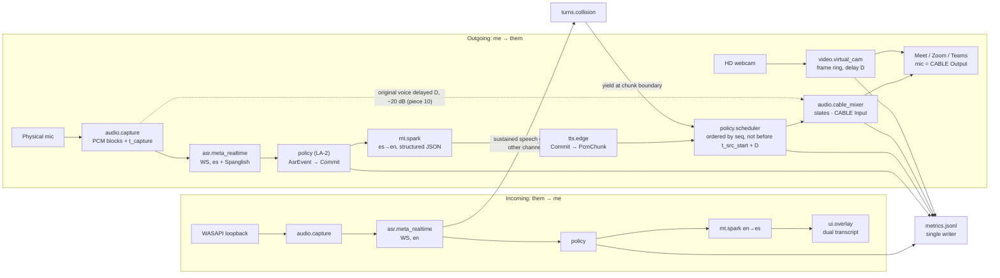

# SPEC — OS-level simultaneous interpreter ES⇄EN on Meta models

Design document for milestone 1 (the only milestone built during the Meta Global AI Developer Hackathon, Oct 26 – Nov 4, 2026). It restates, in my own words, the design knowledge carried over from an earlier prototype (no code is carried over) plus the decisions taken this week. Code follows this document; if they disagree, one of them gets fixed in the same commit.

Status legend: **[verified]** = checked against official Meta docs or measured on this PC, with the date; **[unverified]** = not yet checked in official documentation.

---

## 1. System architecture (Windows 11)

Two independent chains, one per direction. Neither touches the video-call app: it only sees a microphone (the virtual cable) and, later, a camera.

- **Outgoing (me → them).** Physical microphone → streaming ASR in Spanish (Spanglish allowed) → ES→EN translation → English TTS → **virtual microphone**. The TTS is written into VB-CABLE's playback endpoint `CABLE Input`; Meet/Zoom/Teams select `CABLE Output` as their microphone.
- **Incoming (them → me).** WASAPI **loopback** of the system output (a passive tap; the call app does not notice) → streaming ASR in English → EN→ES translation → subtitles in an overlay. **No Spanish voice in my headphones this week:** the loopback would capture it and feed it back into the incoming ASR. If it is ever added, it must play on a device other than the one being captured.
- Audio for the ASR is mono PCM16 at 16 kHz (24 kHz is the engine-native rate and also accepted). The incoming chain never changes audio devices.

```
OUT: mic ─► capture ─► ASR(es) ─► policy ─► Spark(es→en) ─► Pocket TTS ─► scheduler ─► mixer ─► CABLE Input ─► (call app mic = CABLE Output)
IN:  loopback ─► capture ─► ASR(en) ─► policy ─► Spark(en→es) ─► overlay
```

## 2. Two emission modes, built in this order

1. **Consecutive** (the reliable base, built first). Wait for the ASR's end-of-turn (`speechComplete`), translate the whole utterance, synthesize, play. Expect 4–7 s from end of speech. This is the minimum demo. Back-to-back finals queue behind the previous TTS, so consecutive mode is never presented as a guarantee for long sentences.
2. **Incremental** (the target). Commit clauses from the *stable prefix* of the cumulative partials: an irreversible commit roughly every 6–10 words, cut at punctuation, conjunctions, pauses or `speechEnd`, or after ~2 s of speech. Translate each delta in order, **pre-synthesize** the next delta while the current one is playing, keep an ordered PCM queue, apply a **1.1× catch-up** when the backlog exceeds 3 s, and drop stale work.
   - **Hard rule: what is committed is never revised.** Audio that has played cannot be taken back. Late ASR corrections to committed text are counted (`corrections_blocked`) and ignored.

   - **As built** *[measured 2026-10-30]*: a word is stable when two consecutive partials agree. A clause closes at punctuation (≥ 3 words), before a conjunction (≥ 3 words), at 8 words or after 2 s. A forced cut (words, time) backs up to before the last preposition or conjunction, because Spanish puts the adjective after the noun and "para empresas | medianas" came out as "for companies | medium-sized". After 0.7 s of audio with no new word a clause of at least 3 words closes too, last word included: no partial is coming to confirm it, and a real voice left clauses waiting 2.8 s (`audioProgress` arrives every 77 ms, so the pause is seen as it happens; at 0.4 s plain speech gets cut, 38 clauses for 32). `speechEnd` flushes the rest. Translation and synthesis run two at a time: a clause queued behind the previous one was the p95, and `seq` keeps the order. The voice speeds up to +25 % by word count against the clause's spoken length (isochrony, §4.1 of the plan), +10 % at least when more than 3 s behind.

### 2.1 Output queue keyed by source time (foundation for the synchronized dub)

Every PCM chunk carries `t_src_start` (when its clause started being spoken) and is played at `t_src_start + D`, not "as soon as possible". With `D = 0` this degenerates to the classic behaviour (consecutive and incremental as in the prototype). The queue is written this way from day one so that the synchronized dub (piece 10) is a parameter, not a rewrite.

### 2.2 Emission policy v2 (what exists, what is added, what is not done)

- **Base: local agreement LA-2.** A word is stable once it appears in the common prefix of the last two cumulative partials. A clause is cut at punctuation, or at a conjunction with at least 3 new words. This is the policy family that won the IWSLT 2022 SimulST task (CUNI-KIT) and that NAIST has used since. (The cognitive analogue, Marslen-Wilson's cohort model, is the intuition: recognize before the word ends. It is not the technique.)
- **Addition 1 — speculative translation of the unstable prefix.** While a clause is forming, an async task translates the not-yet-stable prefix with Spark; if LA-2 then confirms the same text, the translation already exists and Spark's 0.5–1 s is saved; if the partial changed, the result is discarded. **At most one speculation in flight per channel**, obsolete ones are cancelled. Cost: 2–3 Spark calls per clause, tracked by `mt_calls_per_commit` and `speculation_hit`.
- **Addition 2 — "can I translate what I have?" is decided by the same Spark call**, not a separate classifier (an extra call per decision would eat the gain). Structured output `{"translatable": "...", "translation": "...", "remainder": "..."}`: translate what can already be closed, hand back the rest. A commit needs both ASR stability (LA-2) and semantic sufficiency (`translatable`). **Cap:** semantic sufficiency may delay a commit by at most 1 s beyond what LA-2 alone would have committed; past that, translate what there is (`boundary = "time"`).
- **Addition 3 — "interpretese" instruction.** Spark translates like a simultaneous interpreter, not a document translator: near-monotonic order, short clauses joined by conjunctions, no backward reordering, no sentence openings that require knowing the end; every chunk must be continuable without correcting what was already said (He, Boyd-Graber & Daumé, NAACL 2016).
- **Not done:** one thread per fragment with independent translations (inconsistent, out of order, and emitted audio cannot be corrected); a separate classifier; more than one speculation in flight; revising commits. Ordering already exists: `utterance_id` + `commit_id` + `seq`. In Python these are `asyncio` tasks, not threads.
- **When:** LA-2 on Saturday (60 s gate). Speculation, structured sufficiency and interpretese only if the gate passes, as a measured A/B in the JSONL. Expected gain: commit → first PCM from 2–4 s towards 1.5–2.5 s; the clause wait itself does not drop below 1.5–2 s.

### 2.3 Turns

**Their sustained speech takes the floor from my voice.** `turns/floor.py`: four words and a second since `speechStart`, because the English fixture reaches four words 1.4 s in and "I see." or "That sounds great." stay short of them. The floor expires 4 s after the last word from the ASR: a link that dies mid-turn must not hold my voice for the rest of the call.

When it happens and my voice is busy, the mixer finishes the clause it holds and every clause behind it is dropped by `seq`, not by utterance: I may go on talking, and what I say after they stop still counts. Clauses said while they hold the floor are dropped too. What was dropped shows in grey under a red strip until I speak again. Metrics: `turn` events `yield`, `unsaid`, `floor_back`; a given-up clause is not a lost one. `gate_60s.py` passes `--no-yield`, because its two fixtures talk over each other by design.

## 3. Operational safety

- **The receiver only hears English.** That is why the output is a virtual microphone: at rest the cable carries silence, and raw Spanish reaches it only when I choose (F9) or while the ASR is down.
- Outgoing mixer states: `SILENT` (rest), `TTS`, `PASSTHROUGH` (raw voice), `MUTE`, plus `DUB` for piece 10 (state machine in §7.6).
- The TTS takes over the cable only when its first PCM arrives. Errors, timeouts or cancellation clear the buffers and return to rest.
- **Watchdog of 2 s** on the mixer callback and on scheduler progress.
- **Kill switch F9 in < 200 ms**, latching passthrough until the next F9 (restarting the app mid-call would drop the microphone).
- **F10 restores the physical microphone as the Windows default in < 1 s** via the Windows Core Audio API (`pycaw`/`comtypes`). Not SoundVolumeView (its licence forbids commercial redistribution).
- On exit — including exit by exception — everything is restored (`finally` + `atexit` + signal handler).

## 4. Metrics (one JSONL line per event, in `logs/`)

A single writer task owns the file. Every event is a dict with `ev` ∈ {`run`, `asr`, `commit`, `mt`, `tts`, `play`, `state`, `video`} and the fields below; p50/p95 summaries per path come from `metrics/summary.py`.

| Group | Fields |
|---|---|
| Pipeline | `t_audio`, `t_partial_first`, `t_commit`, `t_mt`, `t_tts_first`, `t_tts_end`, `backlog_s`, `commit_id`, `utterance_id`, `corrections_blocked`, `cable_gaps`, `bytes_written`, `bytes_expected` |
| Piece 10 (dub) | `t_src_start`, `t_src_source`, `deadline`, `t_play_start`, `sync_err_s` (actual play minus deadline), `delay_s`, `stretch_ratio`, `voice_under_db` |
| Policy v2 | `mt_calls_per_commit`, `speculation_hit`, `translatable_ratio` |
| Order and turns | `seq`, `seq_skipped`, `yields` |
| ASR characterization | `partial_interval_s`, `endpoint_delay_s`, `prefix_revisions` |

All `t_*` fields use one clock (§7.2). No gate is considered passed without these numbers.

## 5. Gates

- **60 s monologue, incremental mode:** commit → first PCM **mean 2–4 s, p95 ≤ 4 s**, 0 audible corrections, 0 cable gaps, 100 % of bytes written to the cable.
- **Bidirectional human test in Meet** with a second account or device: the remote hears English, I see Spanish.
- **Declared baseline of the earlier prototype** (other providers, Aug 2026): 2.3–2.6 s mean, 2.9–3.6 s p95. Goal this week: match or beat it **on Meta**, measured on screen.
- **Gate S (piece 10):** 60 s monologue with fixed D: p95 |`sync_err_s`| ≤ 0.5 s, no chunk played more than 1 s after its deadline, and a 20 s clip of what the remote sees where lips and voice start and stop together. `scripts/gate_sync.py` judges the numbers and also prints what the gate cannot see: `t_src_start` against the fixture's real word times, and the real delay of the voice on the cable. `--voice` runs it as defined, on a real voice and camera, with the microphone as the truth for where a turn opens, and records the clip with ffmpeg. The clip is stamped on arrival: the OBS driver and the cable keep clocks hours apart (audio at −13 231 s in the first file), and stamped on arrival the file agrees with the direct reading to 19 ms, under a frame. The script is stricter than the gate: it also fails a run that lost a clause, except one whose deadline falls after the app closed, which it counts apart as `after_the_end`.

## 6. Known traps (already solved once; do not rediscover)

- **Bluetooth headphones:** never open the Bose microphone (it switches the headset to HFP and degrades both directions); disable "Hands-Free Telephony" on the device.
- **Meet must stay unmuted** with `CABLE Output` selected; Meet's own mute blocks the whole track while our logs look green. Turn off Meet's noise cancellation.
- **Realtek mic array WASAPI endpoint fails intermittently** (`WDM-KS 0x492`): two attempts, then fall back to the shared duplicate of the *same* device (another host API), never to the jack mic.
- **Edge TTS adds leading and trailing silence** per request: trim only PCM silence, conservative threshold, 60 ms margin; never cut speech.
- **Cable sample rate:** open `CABLE Input` at the endpoint's real rate (`sd.query_devices(i)["default_samplerate"]`) or with WASAPI auto-convert; never assume 48 kHz. Same for the mic: request 16 kHz with auto-convert, or resample with `soxr`. *[verified 2026-10-29 on this PC: WASAPI `CABLE Input` 48 000 Hz, `CABLE Output` 48 000 Hz, Realtek mic array 48 000 Hz; MME/DirectSound duplicates report 44 100 Hz]*
- **VB-CABLE** is installed on this PC (one cable is enough with a passive incoming tap). *[verified 2026-10-29]*
- **Headphones are mandatory on my side.** With speakers, the mic captures the remote's voice and the outgoing chain translates it back (translated echo). `scripts/warmcheck.py` warns when the default output does not look like headphones (name heuristic; never blocks).
- **Windows volume of `CABLE Input`.** The slider of the playback endpoint scales everything written to the cable, and no log shows it: at 22 % (−23 dB, found on this PC 30/10) the English voice reaches the call at −41 dBFS and every internal number still looks perfect. Both `warmcheck.py` and the app read it at start and warn; it is set by hand, once, to 100 %.
- **Left running, the interpreter keeps listening.** Everything the mic hears goes to the ASR, including a phone call next to it and music from the speakers, and is written to `logs/` (gitignored). Close it after the call.

---

## 7. Contracts, clock, task map and state machine

The minimum needed so that the deadline queue (Thursday) and the dub (Saturday) speak about the same times. Fields marked ★ feed the gates and may not be removed.

### 7.1 Who talks to whom



### 7.2 Clock

- One clock for the whole process: `time.perf_counter()`. Never `time.time()` in a `t_*` field. Audio and video threads use the same clock as the asyncio tasks.
- Every capture block carries `t_capture` = `perf_counter()` in the callback **minus the block duration**, i.e. the instant of its first sample.
- The ASR speaks in time relative to the start of its stream. When the first block of a session is sent, the session stores `t_capture_first` (that block's `t_capture`, not the send instant). From then on `t_local = t_capture_first + t_asr_s`. On reconnect (60 min session cap) the `session_id` changes and a new `t_capture_first` is stored.
- *[verified 2026-10-29, dev.meta.ai/docs/speech-to-text and cookbook `06_muse_voice/02_voice_chess_cua/.../asr_protocol.py`]* Every realtime event (`speechStart`, `transcript`, `speaker`, `speechEnd`, `speechComplete`, `audioProgress`) carries an integer `audioProcessedMs`. The docs define it as **processing progress, not a word timestamp**; word-level timestamps are not available on the realtime endpoint (turn-level `startMs`/`endMs` exist only in the one-shot `transcribe` response). So `t_asr_s = audioProcessedMs / 1000` is the stream position the server had consumed when it emitted the event.
- Corollary: `t_recv − (t_capture_first + t_asr_s)` is the pure transport + buffering lag of an event, measurable on every frame.

### 7.3 The three contracts (`src/interprete/contracts.py`)

No module hands another raw JSON or anonymous tuples.

- **`AsrEvent`** (frozen): one normalized server frame. `channel`, `kind` (`speechStart`, `speechEnd`, `speechComplete`, `partial`, `final`, `speaker`, `audioProgress`, `error`), ★`t_recv`, `session_id`, `turn_id`, `text` (the cumulative transcript of the turn), `t_asr_s`, `speaker`, `raw` (debug log only).
- **`Commit`**: one committed clause, irreversible from birth. ★`utterance_id` = `f"{channel}:{session_id}:{turn_id}"`, ★`commit_id` (0, 1, 2… inside the utterance), ★`seq` (global per-channel counter assigned at creation; **playback order is `seq` order**), `channel`, `text_src` (this clause's delta), `prefix_src` (what was committed before in the utterance, as context), `boundary` (`punct | conj | pause | speechEnd | speechComplete | words | time`), ★`t_src_start`, `t_src_end`, `t_src_source` (`asr_ts | speech_start | partial_arrival`), ★`t_commit`, `text_tgt`, `remainder`, ★`t_mt`, `mt_calls`, `speculation_hit`.
- **`PcmChunk`**: audio ready for the cable, created by `tts/`, consumed by the scheduler. `utterance_id`, `commit_id`, ★`seq`, `channel`, `pcm` (int16 LE mono, silences already trimmed), `sample_rate` (**the cable's real rate**, 48 000 on this PC), `duration_s`, `t_src_start`, `t_src_end`, ★`deadline` = `t_src_start + D`, `stretch_ratio`, ★`t_tts_first`, `t_tts_end`, ★`t_play_start` (written by the scheduler when handing the chunk to the mixer) and the derived ★`sync_err_s = t_play_start − deadline` (gate S).

Video uses `(t_capture, frame)` pairs in a `collections.deque`; the frame emitted is the newest with `t_capture ≤ now − D`.

### 7.4 Where `t_src_start` comes from

This decides whether the dub looks synchronized. In order of preference; `t_src_source` records which one was used:

1. **`asr_ts`** — `t_capture_first + t_asr_s` of the clause's first word, if the ASR gives word or segment times. *[verified 2026-10-29: it does not; only `audioProcessedMs` per event.]* The closest available is the `audioProcessedMs` of the `speechStart` event (for a turn's first clause) and of the first partial containing the clause's first word (later clauses). These are processing positions, so they trail the true onset by the server's detection delay; that bias is measured once and subtracted.
2. **`speech_start`** — for a turn's first clause: the turn's `speechStart`, via its `t_asr_s`, else `t_recv − lat_asr`.
3. **`partial_arrival`** — for later clauses: a line through the stream positions at which the clause's words and the six before them first appeared, read at the clause's first word, minus `WORD_LAG_S`. The position of a single partial is not enough: one word can surface late, and the first version (that position minus one word) was 0.44 s late at p50.

**`mic_onset`** replaces either of the last two when the microphone heard a phrase open near the estimate (1.6 s before it to 0.4 s after) and the clause before can have ended by then, at 0.25 s per word: without that, a clause cut mid-phrase took an opening that belonged inside the clause before it, up to 1.26 s early. Mid-turn the ASR does not report a pause, and words surface in bursts: on a real voice 6 of 16 phrases came out over 0.5 s late against the lips, 3 of them over 1 s, and the gate could not see it because `sync_err` compares against this same estimate. `audio/onsets.py` reads energy on the capture clock, to one block, so it is also immune to a shift in the ASR's stream position. Clauses that start mid-phrase keep the line: the lips are already moving there.

**As measured on Friday (Oct 30)** against the word times Edge reports for the fixtures (`scripts/make_fixtures.py`, about 0.06 s ahead of the energy onset): `speechStart` sits 0.26 s *before* the first word (p50, ±0.22 at p95, 35 turns), and a word starts 0.69 s before the partial that first carries it. Both are constants in `policy/incremental.py`. The line takes the spread of a mid-turn clause from ±0.59 to ±0.38 s (p95, 157 clauses, 7 runs); a per-turn calibration of the lag was tried and is worse (±0.58): one word is too noisy to calibrate on. They are measured on synthetic voices; on a real voice the ASR lags 0.4 s more (§4 mic vs. fixture) and `gate_sync.py --voice` measures what remains. On a real voice the offset also holds: +0.05 s at p50 over 6 turns, placed through the raw voice on the cable. For a day it looked 0.33 s late and was removed, but the microphone file had lost samples while the models loaded and read 0.22 to 0.48 s early; `Recorder` now keeps lost stretches as silence.

`t_src_end` is the same line read one word past the clause: where the next word would start. Gate S checks the scheduler against the deadline; the error of `t_src_start` itself is printed by `scripts/gate_sync.py` on every fixture run, and with `--voice` for a real voice at every phrase that opens after a pause, which is what the other side sees. The clap (`scripts/calibrate_av_offset.py`) measures something narrower: picture against the raw voice on the two delay lines, corrected with `RTT_AV_OFFSET_MS`. It never passes through the ASR. Measured with real claps: 6 of 6, +23 ms, spread 0.108 s.

### 7.5 Asyncio task map

One `asyncio.TaskGroup` per channel plus a shared one. `sounddevice` callbacks and OpenCV threads are not tasks: they hand data to asyncio with `loop.call_soon_threadsafe` and never block. Queues are bounded `asyncio.Queue`s; the PCM queue drops the oldest block rather than block capture.

| Task | Reads | Writes | Does | On cancel / failure |
|---|---|---|---|---|
| `capture[c]` (callback) | device (mic and cable via `sounddevice`; loopback via `pyaudiowpatch`) | `q_pcm[c]` | 20 ms blocks with `t_capture` | never blocks; underruns counted |
| `asr_send[c]` | `q_pcm[c]` | WS (binary) | resample to 16 kHz mono; store `t_capture_first`; never more than 5 s ahead of real time; reconnect at 55 min with `endStream` + new session | WS error → reconnect with backoff; channel stays in passthrough meanwhile |
| `asr_recv[c]` | WS (text) | `q_events[c]`, `q_metrics` | normalize to `AsrEvent`; keep the clock mapping | ASR `error` is logged and treated as a cut |
| `policy[c]` | `q_events[c]` | `q_commits[c]` | consecutive: one `Commit` per `speechComplete`; incremental: LA-2 over cumulative partials; derive `t_src_start` (§7.4); at most one speculation task in flight | committed text untouched; late correction → `corrections_blocked += 1` |
| `mt[c]` (two at a time on `out`) | `q_commits[c]` | `q_translated[c]`, `q_metrics` | Spark with `prefix_src`, the last N commits of both channels and the glossary; structured output; minimum reasoning | 4 s timeout → **tombstone** to the scheduler, counted; overlay shows source text in grey; never waits unbounded |
| `tts[out]` | `q_translated[out]` | `scheduler.submit()` | Pocket TTS, with Edge taking a clause it fails or holds 3 s (§10) → PCM at cable rate → trim silences → `rate` from characters and `t_src_end − t_src_start` (isochrony) → `PcmChunk`; runs ahead of playback, so pre-synthesis comes for free | keeps trying for 6 s, then tombstone, counted |
| `overlay[in]` | `q_translated[in]` | UI | EN/ES subtitles; backchannels as text only | — |
| `scheduler` (one per output; only `out` this week) | heap by `seq` + tombstones | mixer ring, `q_metrics` | see §7.5.1 | F9 empties heap and ring |
| `mixer` (output callback, `CABLE Input`) | TTS ring, delayed-voice ring, live mic ring | cable | sums by state (§7.6) | underrun → zeros, `cable_gaps += 1`; never blocks |
| `turns` | copy of `q_events[in]` | `scheduler.yield_current()`, UI | **sustained** speech on IN while OUT is playing (≥ 0.7 s without `speechEnd`, or a partial with ≥ 3 words; an "uh-huh" does not count) → **yield the turn**: the current chunk finishes (200 ms fade in DUB), the rest of the utterance is dropped and shown in grey on my overlay, red band, `yields += 1`. No resumption | piece 3 (Sunday); `yield_current()` exists from Thursday |
| `video` (two threads) | HD webcam by name | OBS Virtual Camera | capture → deque → emit frame with `t_capture ≤ now − D`; title card during the first D s; D fixed per session | piece 10 (Saturday); F9 jumps to live together with audio |
| `safety` | hotkeys, watchdog | mixer state, `q_metrics` | launching is "Ready"; F7 plays the initial notice, F8 pause/mute, F9 kill (< 200 ms), F10 restore default mic (< 1 s, pycaw); 2 s watchdog | `finally` + `atexit` + signal: restore device, close cable, last virtual-camera frame = title card |
| `metrics` | `q_metrics` | `logs/run_<date>.jsonl` | single writer; one line per event | on disk failure keep running without metrics and say so |

The unit of cancellation is `utterance_id`: F9 and turn yields mark utterances cancelled; `mt`, `tts` and the scheduler check before every step. Speculation tasks are children of `policy[c]`. Reconnecting the ASR changes `session_id`, so `utterance_id`s never collide.

#### 7.5.1 Scheduler rules (ordered by `seq`, deadline = "not before")

Why `seq` and not deadline order: TTS jobs can finish out of order, and emitted audio cannot be corrected, so the only safe emission order is the commit order. The deadline only says *not before*.

1. The head of the queue plays when `now ≥ deadline_eff` **and** the previous `seq` has already played or has a tombstone. `deadline_eff = max(deadline, end of the previous chunk on this channel)`.
2. `mt` and `tts` always deliver something for every `seq`: the `PcmChunk` or a tombstone (`scheduler.tombstone(seq)`) when they drop it for timeout, error or cancellation. Tombstones are what keep a dropped clause from stalling everything behind it.
3. Safety net for a missing `seq` without tombstone (a bug, not a normal path): skip it once both stages had the chance to answer, `max(deadline, t_commit + mt_timeout + tts_timeout) + 1 s` (`seq_skipped += 1`), and drop it if it arrives later. A clause that is merely late still plays: with `D > 0` it sounds on arrival with `sync_err_s > 0`. The first version skipped 1 s past the deadline, which lost clauses that were only slow; a late clause costs a moment of sync, a lost one costs the sentence.
4. The scheduler writes `t_play_start` on handoff to the mixer.
5. Catch-up +10 % when the backlog exceeds 3 s (`D = 0`) or the clause would start more than 0.5 s past its deadline, counting what still plays before it (`D > 0`). Three clauses in a row more than 1 s late: the bar proposes restarting with D + 0.5 s. D never changes by itself.
6. Chunks of cancelled or yielded utterances are dropped.

### 7.6 Outgoing mixer state machine

| From → to | Trigger | What the cable carries |
|---|---|---|
| `OFF → SILENT` | launch ("Ready"): cable open, mic capturing, ASR connecting | silence |
| `SILENT → TTS` (`D = 0`) | the scheduler hands over the first `PcmChunk` | TTS only |
| `TTS → SILENT` | heap empty and nothing in flight 300 ms after the last chunk ended; or error, timeout, watchdog (buffers cleared) | silence |
| `SILENT ↔ PASSTHROUGH` | the ASR drops and comes back: while nothing can be translated, the other side at least hears me | live voice |
| `any → PASSTHROUGH` | F9 (buffers cleared, latched; no chunk takes the cable while latched) | live voice |
| `PASSTHROUGH → SILENT` | F9 again | silence |
| `OFF → DUB` (`D > 0`) | `--dub`: DUB takes the place of `SILENT` as the rest state; the delay line fills, the first D s are silent while the virtual camera shows the title card | original voice delayed D at −20 dB + TTS at its deadlines; **never leaves on its own between clauses** |
| `DUB → PASSTHROUGH` | F9, a fatal error, or the ASR down > 3 s: audio and video jump to live **together** (one cut, never desync) | live voice |
| `PASSTHROUGH → DUB` | F9 again, or the ASR back: the delay line and the frame ring start over, so what was heard live is never heard twice | silence and title card for D s, then as above |
| `any → MUTE` | F8 | silence |
| `MUTE → previous` | F8 again | whatever was there |
| `any → OFF` | normal close or exception | cable closed; F10 restores the default mic, also without closing |

Yielding the turn does not change state: in `TTS` the heap empties and after 300 ms it returns to `SILENT`; in `DUB` it stays in `DUB` (the remote sees up to D seconds of silent lips: accepted cost, never a jump). Measured: F9 < 200 ms from key to first live-voice block; F10 < 1 s; watchdog 2 s. Every transition is a `state` event in the JSONL.

The watchdog does not cancel a clause that is merely slow: if the next clause is still in Spark or TTS more than 2 s after the last audio, the cable goes back to rest and the clause retakes it when ready. Only a stalled callback or a scheduler that stopped stepping clears the work in flight. In a dub the watchdog empties the TTS and stays in `DUB`: as at `D = 0`, raw voice at full level only ever comes from F9 or the ASR fallback.

The delay line (`audio/delay.py`) is written by the mic callback and read by the cable callback, two devices with two clocks. Its fill level is the delay, so that is what it watches: drift or a stall moves the level, and past ±40 ms the reader jumps back to D. Under the TTS a jump is not heard; a delay that wanders away from the video would be seen.

---

## 8. Meta Model API facts this design relies on

- Base URL `https://api.meta.ai/v1`, key in `MODEL_API_KEY`, OpenAI-SDK compatible. Spark model `muse-spark-1.3`, structured output and reasoning levels (use the lowest for translation). *[from dev.meta.ai/docs, read 2026-10-27]*
- Realtime ASR `wss://api.meta.ai/v1/asr/realtime`, model `muse-voice-transcribe-1.0`. *[verified 2026-10-29, docs + official cookbook `06_muse_voice/01_voice_api_fundamentals`]*:
  - First text frame = handshake, within 10 s: `mode` (`PUSH_TO_TALK` default, `ENDPOINTING`, `DIARIZATION`; fixed for the session), `authorization.accessToken`, `audioEncoding` (`PCM_24KHZ` engine-native, or `PCM_16KHZ`), `model`, `partialMode` (`CUMULATIVE` default, or `DELTA`), `emitAudioProgress`, optional `keywords` and `languageBias` (hints, not constraints). The ack is a bare `{"sessionId": ...}` with no `type`; send audio only after it.
  - **`accessToken` format differs between sources:** the docs and API reference examples use `"Bearer <key>"`; the cookbook sends the bare key. The client sends the documented `Bearer` form and falls back to the bare key if the handshake is rejected.
  - **The server silently ignores unknown handshake fields** (cookbook `utils.py`), so a field cannot be "tested into existence".
  - **No endpointing sensitivity / minimum-silence / VAD parameter** appears in the docs pages, the API reference page or the cookbook's protocol module. *[not verified in the full schema page, which was not reachable; treated as non-existent]* Consequence: the delay of `speechComplete` after a pause is the server's, and is measured (§4 `endpoint_delay_s`), not tuned.
  - Binary frames = raw PCM16 mono. The backend processes 80 ms chunks; frame size carries no meaning, smaller frames lower latency.
  - Close codes: `1008` (no handshake in 10 s, **more than 5 s of audio backlog**, or **ingress below real time for 10 s** → pad silence during gaps), `1011` (server error or 60 min cap), `1013` (rate limited). End: send `{"type":"endStream"}`, keep reading until close `1000`.
- **The Meta Model API has no TTS.** The docs say Muse Voice Transcribe "does not synthesize speech or provide a speech-to-speech conversation API"; every Meta model lists text, image or masks as output; `/v1/audio/speech` answers 404; the cookbook has no synthesis. *[verified 2026-10-30: dev.meta.ai/docs, /docs/models, live `/v1/models`, cookbook]* Outside the API, Meta's open-weight MMS-TTS exists (`facebook/mms-tts-eng`, VITS, CC-BY-NC 4.0); it has not been evaluated here. So the voice is not Meta's: Pocket TTS on this PC, with Edge behind it (§10), and one ASR, Muse Voice Transcribe. If Meta ships a TTS, it plugs in at `tts/backup.py`. This is stated plainly in the README.
- **Spark can hold a call past its 4 s limit.** 6 of 1066 clauses were lost that way, and 1 to an empty answer. Its p99 is 2.3 s, so a second call races the first at 2 s, which doubles under 2 % of the calls, and a failed or empty answer is asked again at once.

- **Spanish inside English speech is the weakest ASR case,** and the result changes run to run. Spanish words kept out of 13 in `fixture_spanglish` (a synthetic American voice, 6 runs for `en,es`, 3 for the rest): no bias 11, 0, 0; `es,en` 7, 0, 0; `en,es` 10, 10, 8, 11, 4, 0. So the bias is `["en", "es"]`; pure Spanish keeps 15 of 15 words under either order. With terms in `keywords` it reached 10, 11, 13 with `en,es`, but those keywords were written for this fixture, so that is a ceiling. When it fails it skips the passage: nothing reaches Spark. Not measured with a real voice.
- **Spark repairs what the ASR spells wrong** if told how: `SPANGLISH` in `mt/spark.py` lists the patterns seen (`K` for `que`, `no say` for `no sé`, `paces` for `países`) and treats word searching as filler. Over the same clauses no Spanish word was left. A clause that was only a filler comes back empty twice and counts as `filler`, not as lost.
- **Conversation cost.** Spark with 0, 2 000, 8 000, 32 000, 128 000 and 512 000 characters of conversation, p50 of 8 calls: 0.95, 1.01, 1.05, 1.10, 2.06 and 3.64 s, with one call at 16.9 s at 128 000. `mt/context.py` stops at 32 000 characters, about 40 minutes of talk. It changes real clauses: with a question about message queues, "la cola se llena" goes from "the line fills up" to "the queue fills up".

## 9. Edge TTS facts this design relies on *[measured 2026-10-30 on this PC; Edge publishes none of this]*

- **Edge rate-limits new connections, not requests.** `edge_tts` opens one per request: at one every 0.75 s, 52 of 80 failed with `NoAudioReceived` after ~3.2 s, whatever the text; at one every 1.5 s, 1 of 60. A second identical request and one differing by +1 % rate failed alike, so racing a new connection does not rescue a throttled one.
- **One open WebSocket carries many turns.** Same protocol, kept open: 80 of 80 at the same pace, 60 of 60 at one every 0.4 s, first audio p50 0.25–0.27 s against 1.0 s, whole clause 0.36–0.42 s against 1.3 s. The handshake (0.8–1.1 s) was the cost. `tts/edge_session.py` keeps three open: one per worker and a spare.
- **An idle socket dies** between 30 and 60 s, a WS ping does not prevent it, and resending `speech.config` every 10 s does (alive at 150 s, the longest tried). Lifetime under keep-alive beyond that is unknown; a dropped socket reopens in the background.
- **Edge has bad windows.** From 15 s to a minute at a time, turns on healthy sockets take 1–3 s, or the server closes the socket 2.5 s after the request with no close code. In one clean probe, app off, 9 of 127 turns; on the worst run of the day, 4 of 28 clauses timed out at 4 s. No pattern by the hour: runs a minute apart went from 0 to 11 hedges. A stalled turn races the spare socket and a one-shot request at 1.2 s; if everything fails, the clause tries again until 6 s. The 4 s of the first version lost clauses: the server can refuse all of it for more than that.
- **Intermediate `rate` values are worse than 0 and +25 %.** Rate drawn at random per turn in the same window, three experiments: 1 of 262 turns failed at 0 or +25 %, 5 of 179 at anything else, with first audio at p50 0.35 s against 0.23 s in the worst window. Nothing explains it and the sample of failures is small, but the fix costs little: the isochrony uses only those two steps, which leaves the voice within ±12.5 % of the clause, inside the ±15 % goal.
- **Clause length is predicted from characters, not words.** 242 clauses at rate 0: 0.047 s per character plus 0.40 s, residual ±0.13 s, against ±0.29 s for words at 3 per second. "For mid-sized companies" is three words and 1.56 s. An overflow is what makes a clean run miss its deadlines: audio was ready 2 s early and still had to wait for the previous clause to end.

## 10. Pocket TTS facts this design relies on *[measured 2026-10-30 and 31 on this PC, Ryzen 9 6900HX]*

- **The voice is `michael` on the default `english` model,** picked by ear, +3 dB (`RTT_POCKET_GAIN_DB`; a clause that would clip rises less). `george` on `english_18m_2026-10` is half the work and allows D = 5.5, and is one setting away.
- **Time per clause:** p50 1.05 s, p95 1.40, max 1.71 over 219 clauses with 2 threads, using about 4 cores while it speaks. That is 1.2 times real time on these short clauses, not the 6 published. More threads cost twice the cores for 10 % less time, and int8 quantization was slower.
- **D = 7.0 on a real voice.** The plan's cap of 6.5 s was set on `t_tts_first`, which with Edge is audio already sounding; Pocket hands over the whole clause 0.73 s later (p95 0.95). Replayed over 9 runs of one evening, with Spark at 1.3 s: D = 6.5 passes 4, 7.0 passes 7, 7.5 passes 8. Paul's voice alone passes from 6.25. The run that fails at any D is the isochrony cap: two clauses in a row with more English than Spanish, already at +25 %, left the next one 1.55 s late with its audio ready 1.6 s early.
- **Not thread-safe:** clauses go one at a time. No gap on the cable in any run.
- **It can lose the end of speech** and run on in silence to its maximum: 8.1 s with `marius` and 2.9 s with `michael` on the 18M model, in 14 clauses each. None in 219 clauses each with `michael` and `george` on the default model. Generation stops at twice what the text could need.
- **No speed control:** `rate_pct` becomes a WSOLA stretch in `tts/stretch.py`. About a third of the clauses use it. Length is predicted per voice: `michael` 0.0382 s per character plus 0.35 s.
- **Loading takes about 15 s,** 42 s on the first run after an install, so it happens before the audio starts: a call must not change voice halfway. If it fails, Edge speaks every clause and the bar says `VOZ DE RESPALDO`.
- **Licenses:** model CC BY 4.0, `michael` and `george` from VCTK, CC BY 4.0. Voices from `ears` and `expresso`, such as `jean`, `cosette`, are non-commercial and must not be used.

### 10.1 Your own voice *[measured 2026-11-01 on this PC]*

Mechanism taken from how zero-shot voice cloning works, not from any other project's code: `tts/own_voice.py` is written on Pocket's own `get_state_for_audio_prompt` and `export_model_state`. It is offered in `LISTO` only and is optional: nothing changes for someone who says no.

- **A clone costs what a catalog voice costs.** First audio 0.15 s and 2.3 to 2.4 times real time with clips of 8, 12, 15, 20 and 26 s, the same as `michael` on the same sentences. The state grows from 4.5 to 15 MB and reads in 2 ms; cloning takes 1 to 4 s, once.
- **Only making a clone needs the gated weights.** `kyutai/pocket-tts` is gated, approved automatically. Without access Pocket falls back on `pocket-tts-without-voice-cloning` with no error, so `has_voice_cloning` is what tells. An exported state ran on those free weights at the same speed, with clauses of normal length; that audio has not been judged by ear. A state only fits the model that made it, so `Store` keeps the model's name.
- **A clone speaks at the pace of its clip.** Paul reading English: 40 characters in 2.47 s against 1.88 s for `michael`, and 17 of 38 real clauses at the +25 % cap against 5. A faster clip makes a faster clone: ×1.15 gives 2.18 s, ×1.30 gives 1.94 s, ×1.45 gives 1.91 s. So a clip slower than 1.9 s per 40 characters is sped up by WSOLA and cloned again, up to ×1.3. Stretching the clip once replaces stretching every clause.
- **Pace is measured per clone** on ten clauses and saved with it; without it isochrony would use Edge's numbers. Two fits of the same voice split the time differently between characters and clause (0.0509 + 0.42 and 0.0447 + 0.68) and agree on the total, 2.45 and 2.47 s for 40 characters, so the total is what to trust.
- **The notice is not optional with a clone.** Pocket's terms bar passing generated audio as a real recording, and a clone sounds like the person. Pressing the button plays the notice by itself and it says the voice is a synthetic copy. Runs with `--no-overlay` skip it: those are gates, and no one is listening.
- **Consent is in the recording.** The text opens with it, and `Store` keeps the text and the date. Sample, state and pace live in `logs/voice`, which git ignores; a take not approved does not stay on disk.
- **Edge stays as the backup:** a clause Pocket fails or holds 3 s comes out in Edge's voice, not the clone's.

## 11. The band and the sounds

- **The band is as tall as its text** and grows upwards from one spot; after 9 s with nothing new it fades, and it clears only when the fade ends. It stays while they hold the floor, so what they said and what my voice left unsaid can still be read.
- **Sounds are tones made in `ui/sounds.py`,** with no files and no new dependency: QtMultimedia is not in the install, so they go through `winsound` from memory, which blocks, on a thread of their own. They play on the Windows default output and never on the cable. `sound_for` decides them from the change of phase, so the bar's redraw every 0.5 s stays silent. The loopback takes them to the incoming ASR too; they are short, soft and without speech, and that has not been measured.
- **The recording cue plays before the microphone opens,** with 0.4 s to end, so it stays out of the clip.
